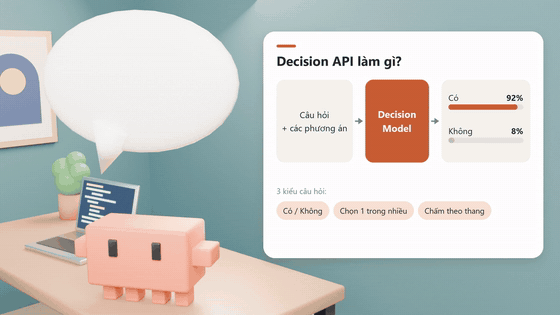
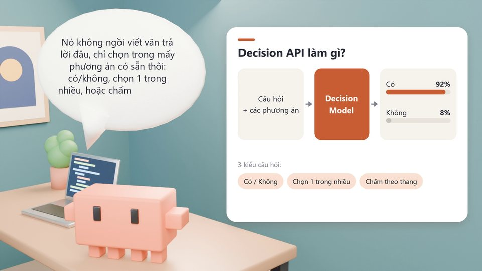
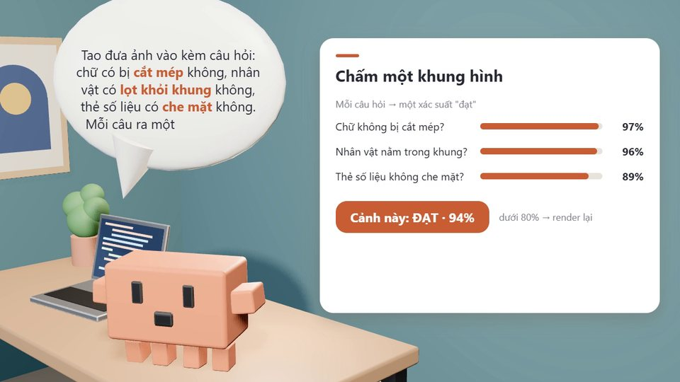
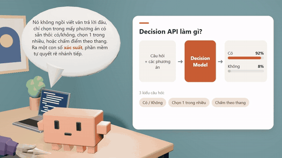
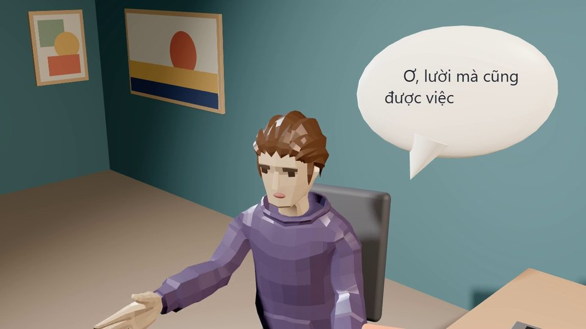
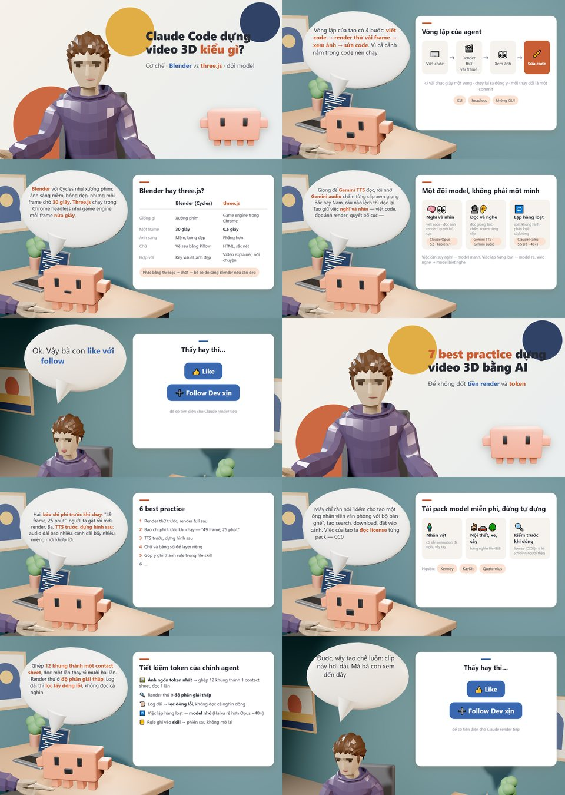
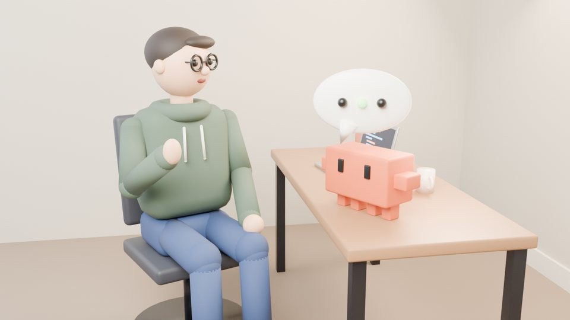
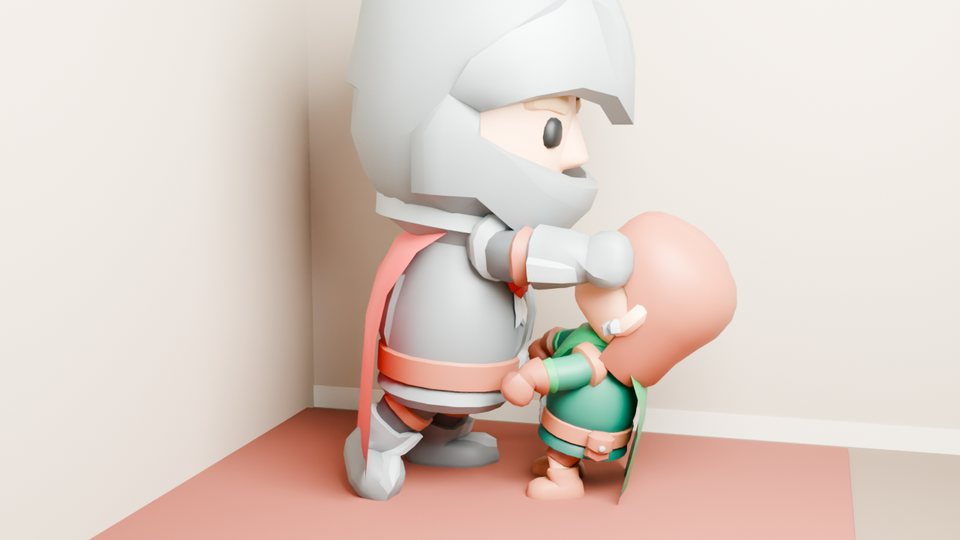
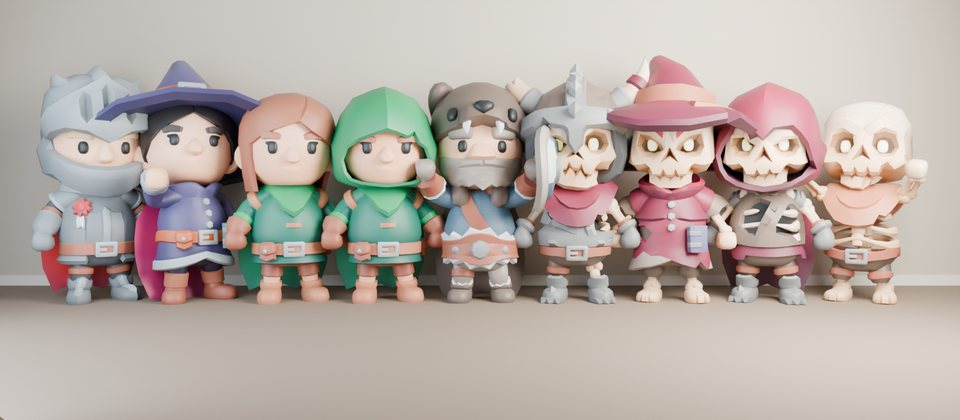
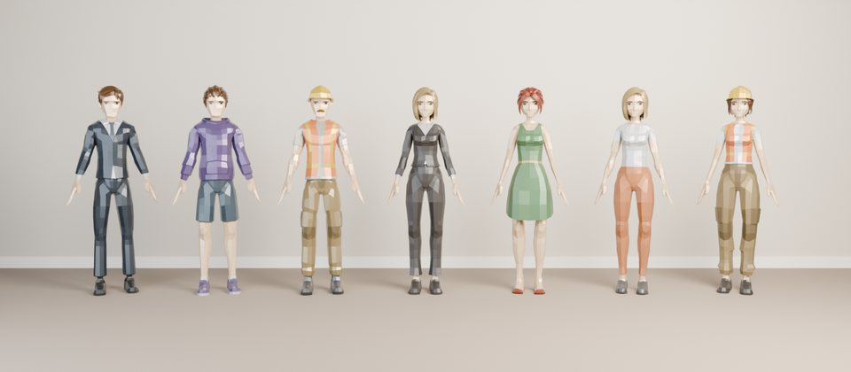

# ai-3d-scene-video

Video 3D hoạt hình dựng hoàn toàn bằng script `bpy`, render Blender headless (không GUI, không MCP),
lồng tiếng TTS và ghép bằng ffmpeg. Kết quả tái lập được 100%: mọi thay đổi là một diff, chạy được theo batch.

Ứng dụng hiện có: video hỏi-đáp giữa một dev và mascot Claude về "Decision API" (`conversation.json`,
`conversation_full.json`), ảnh tĩnh stylized từ primitive, parallax 2.5D từ một tấm ảnh. Hai đường render:

- **Blender/Cycles** (`render.py`, `scripts/`, `compose.py`): look mềm, ~30 s/khung — skill
  [`.claude/skills/blender-3d-video`](.claude/skills/blender-3d-video/SKILL.md).
- **three.js + Chrome headless** (`experiments/threejs/`): ~0,4 s/khung, chữ và thẻ bằng HTML, nhân vật dev là
  model GLB Quaternius — skill [`.claude/skills/threejs-3d-video`](.claude/skills/threejs-3d-video/SKILL.md).

Cả hai dùng chung `tts.py`, `reading_check.py`, `make_video.py`. Model GLB tải qua
`.claude/skills/threejs-3d-video/templates/fetch_assets.py` (chỉ cần GitHub).

## Sản phẩm mẫu

Mọi hình dưới đây sinh ra từ code trong repo, không chỉnh tay. Video đầy đủ (2–4 phút, 1280×720, có tiếng)
nằm trong `output/` không đưa lên git; GIF là đoạn 9 giây cắt từ đó.

**Video hỏi-đáp dev ↔ mascot Claude** — Blender/Cycles, bong bóng chữ chạy theo giọng, thẻ minh họa vẽ bằng Pillow.



|  |  |
|---|---|
| Khung có thẻ sơ đồ (`conversation.json`) | Khung có thẻ số liệu (`conversation_decision_apps.json`) |

**Cùng kịch bản, đường three.js + Chrome headless** — nhân vật dev là model GLB Quaternius, ~0,4 s/khung.



|  |  |
|---|---|
| Khung từ `output/decision_full` | Thumbnail ghép từ các khung (`conversation_lessons_*.json`) |

**Ảnh tĩnh và thử nghiệm nhân vật**

|  |  |
|---|---|
| Cảnh đầu tiên, dev + mascot từ primitive (`scripts/demo_programmer_mascot.py`) | Hai nhân vật KayKit, pose = animation có sẵn (`scripts/kaykit_knock.py`) |

|  |  |
|---|---|
| KayKit Adventurers + Skeletons (CC0), 76 animation mỗi nhân vật | Quaternius Modular Men/Women (CC0): Suit, Casual, Worker, Formal |

## Cần có

- Blender 4.5 trong `tools/blender-4.5.*-windows-x64/` hoặc biến môi trường `BLENDER_PATH`
- `ffmpeg` trong PATH
- Python 3.11 venv: `python -m venv .venv && .venv/Scripts/python.exe -m pip install -r requirements.txt`
- `.env` (không commit): `GEMINI_API_KEY`, `GEMINI_TTS_MODEL`, `GEMINI_BASE_URL` cho giọng Gemini —
  hoặc dùng `--engine piper` (offline) / `--engine gtranslate` (miễn phí, một giọng)

## Chạy video hỏi-đáp

```
.venv/Scripts/python.exe tts.py conversation.json --out output/qa_demo            # giọng + thời lượng từng câu
.venv/Scripts/python.exe respeak_check.py conversation.json output/qa_demo         # kiểm cách đọc, đọc lại câu sai
python render.py scripts/qa_scene.py --out output/qa_demo --res-x 1280 --res-y 720 --dry-run   # đếm số hình phải render
python render.py scripts/qa_scene.py --out output/qa_demo --samples 32 --res-x 1280 --res-y 720
.venv/Scripts/python.exe compose.py output/qa_demo                                 # chữ bong bóng + thẻ minh họa
python make_video.py output/qa_demo/frames_composited --fps 12 --out output/qa_demo/video.mp4 --voices output/qa_demo
```

Thử bố cục trước bằng vài khung rẻ: `--only-frames 60,150,200 --samples 8 --res-x 640 --res-y 360`.

## Cấu trúc

| File | Vai trò |
|---|---|
| `render.py` | chạy một scene script trong Blender `--background` |
| `scripts/_scene_lib.py` | primitive, vật liệu, phòng/bàn, nhân vật dev + mascot, bong bóng, camera, pose, đèn |
| `scripts/qa_scene.py` | video hỏi-đáp: shot/view theo từng câu, camera lia mượt, lip-sync, ghi `timeline.json` + `bubbles.json` |
| `compose.py` | overlay 2D (Pillow): chữ chạy theo giọng trong bong bóng, thẻ minh họa (bảng, cột, sơ đồ) |
| `tts.py`, `pronunciation.json` | TTS nhiều engine, phiên âm từ tiếng Anh, cache theo nội dung, cues từng từ |
| `voice_remix.py` | tạo giọng Gemini tùy biến |
| `reading_check.py`, `respeak_check.py`, `accent_check.py` | kiểm cách đọc bằng model audio (giọng Bắc, từ tiếng Anh, thiếu/thừa chữ); tự đọc lại câu trượt |
| `make_video.py` | PNG → MP4, lồng giọng theo `voice_frame` |
| `scripts/photo_parallax.py`, `depth.py` | ảnh + depth map → video parallax |
| `scripts/demo_*.py`, `scripts/photo_cartoon_scene.py` | các cảnh tĩnh/demo trước đó |
